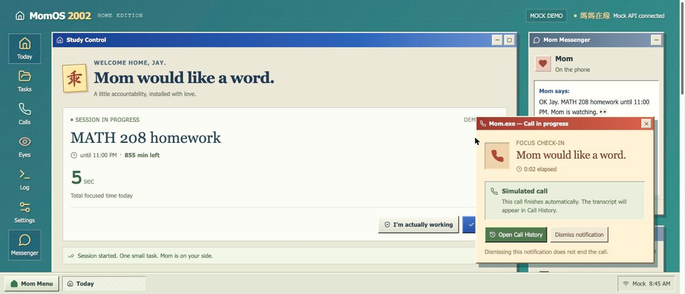
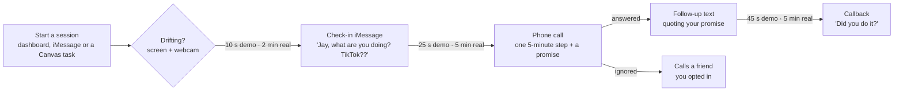
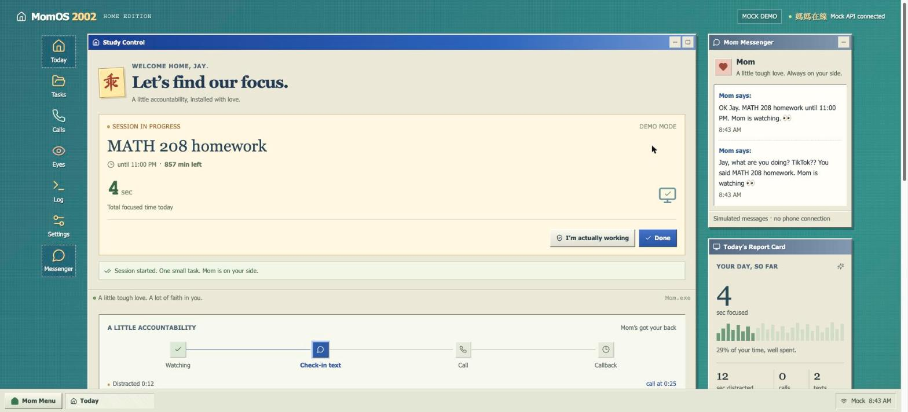
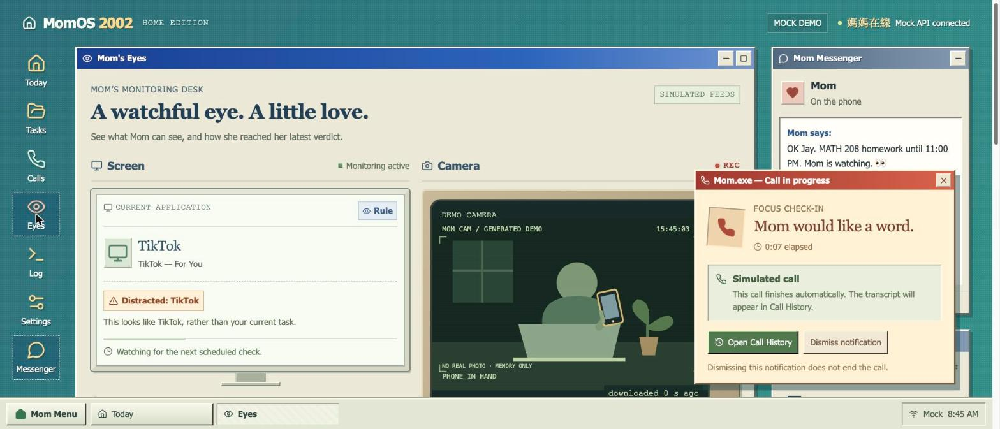
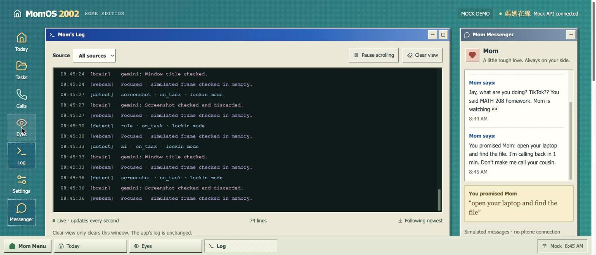
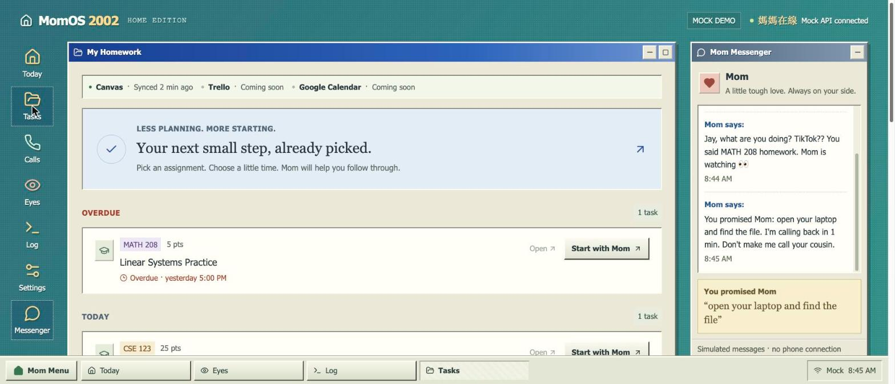
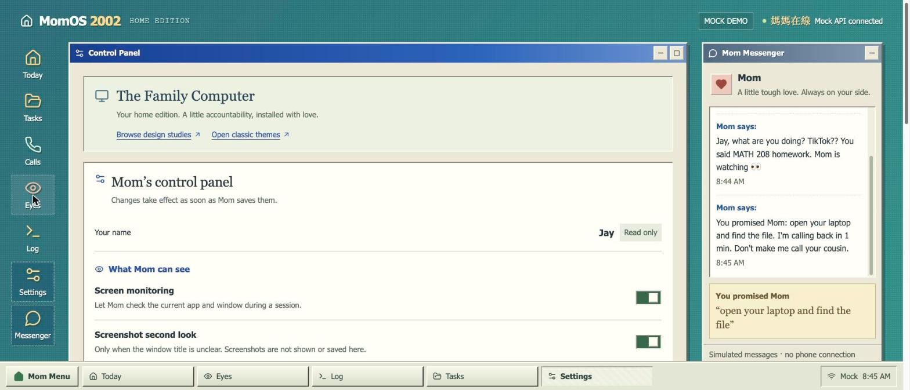
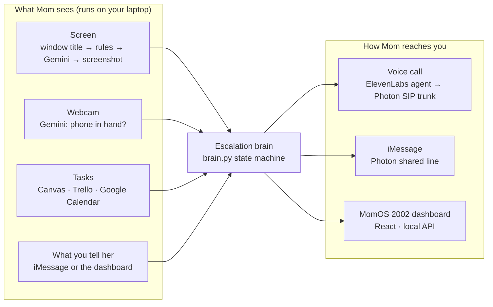

# Mom.exe

**It's basically your mom with an API key.**

Mom.exe is an AI accountability agent. It watches you work, texts you when you drift to TikTok, and
then actually **phone-calls you**. On the call it doesn't just yell: it asks what's blocking you,
shrinks the task into one five-minute step, gets your promise, texts it back to you, and calls back to check.

Built at **DubHacks '26** for the **Cook Smarter** track.



<sub>Screenshots are from the dashboard's scripted demo mode (`?mock=1`), so they show sample data.</sub>

## Why

Productivity tools are easy to ignore. A notification gets swiped away, a blocker gets turned off,
a screen-time limit becomes "15 more minutes". And procrastination is usually avoidance: the task feels
too big to start. You don't need another alarm. You need someone who calls you and helps you take the
first step, the way a mom would.

## What Mom does



- **Watches**: the active window and browser tab (rules first, Gemini when unclear, a screenshot only as a
  last resort) and, optionally, the webcam for a phone in your hand.
- **Escalates**: a check-in iMessage, then a real phone call, then a follow-up text and a callback.
  Ignore her and she calls the accountability buddy you opted in.
- **Coaches**: on the call, Mom asks what's blocking you and keeps shrinking the step until you say yes.
  The promise and your excuse are pulled out of the call automatically.
- **Knows your work**: start a session straight from your **Canvas** assignments, **Trello** cards or
  **Google Calendar** events.
- **Takes corrections**: say "I'm actually working" and she stops flagging that app for the session.

## A real call

From a live test call (48 seconds). Jay refuses twice; Mom shrinks the step each time.

> **Mom:** Jay! 5 min on TikTok?! Cousin Kevin would never. What are you stuck on with CSE homework?<br>
> **Jay:** I don't know how to start.<br>
> **Mom:** Okay okay, don't panic. Just open the assignment PDF and read problem one out…<br>
> **Jay:** I don't wanna.<br>
> **Mom:** Aiyah, I hear you. Just open the PDF, that's it, you don't even have to read it yet. Promise?<br>
> **Jay:** No, I don't.<br>
> **Mom:** Okay okay, Mom makes it even smaller. Just open your laptop and find the file. That's all. Promise?<br>
> **Jay:** Okay.<br>
> **Mom:** Good! Mom calls back in five minutes. Bye bye!

Then the follow-up text: *"You promised Mom: open your laptop and find the file. I'm calling back in 1 min.
Don't make me call your cousin."*

## The dashboard: MomOS 2002

A retro "family computer" desktop that shows exactly what Mom sees and why she decided it.

| | |
|---|---|
|  |  |
| **Study Control.** The session, the escalation ladder and Mom's texts. | **Mom's Eyes.** What's on screen, how she judged it (rule, AI or screenshot), and the camera. |
|  |  |
| **Mom's Log.** Every decision, live. | **My Homework.** Canvas, Trello and Calendar tasks; start a session from any of them. |



**Control Panel.** Real switches: screen monitoring, screenshot second look, camera, lock-in mode, demo timing, AI model.

## How it works



- `main.py` is the loop. It polls iMessage, checks the screen every few seconds, runs the webcam in a
  background thread, and serves the dashboard API on `127.0.0.1:8765`.
- `brain.py` is a pure state machine (no network, no clock) that decides when to text, call, call back
  or call the friend. Unclear screens never start a streak but don't interrupt one either.
- `caller.py` places an outbound call through an **ElevenLabs** voice agent over a **Photon** SIP trunk.
  The agent's Data Collection returns the promised step and the excuse as structured data.
- `detector.py` uses rules for obvious distractions (TikTok, Instagram, Shorts, iPhone Mirroring) and
  **Gemini** for everything else; `webcam.py` asks Gemini whether you're holding your phone.
- `web/` is the React + Vite dashboard. More detail: [INTERFACES.md](INTERFACES.md) and [docs/UI_SPEC.md](docs/UI_SPEC.md).

## Measured

| What | Result | Source |
|---|---|---|
| Mom's reply time on a call | 0.5 to 1.0 s | ElevenLabs turn metrics on real calls |
| Call cost | about $0.10 per minute | 5 real calls: $0.195 for 124 s |
| Phone-in-hand detection | Gemini caught 6/6 phones in frame, 0 false alarms in 9 no-phone shots | our benchmark of 5 vision models on hand-labeled webcam shots |
| Flagging TikTok / Instagram / Shorts | instant (rules, no AI call) | `detector.py` |
| Judging an unclear window | about 0.8 s (title) / 1.6 s (with screenshot) | Gemini 3.5 Flash-Lite |
| Automated tests | 59 dashboard + 61 calendar | `cd web && npm test`, `pytest tests` |

## Privacy and safety

- **Title first, screenshot last.** A screenshot is taken only when the window title is unclear, and it's deleted right away.
- **Webcam frames stay in memory.** Nothing is written to disk.
- **You can correct Mom** ("I'm actually working"), and she never flags that app again in the session.
- **Friends opt in first**, and Mom says she's an AI when asked. If you sound stressed, she drops the jokes.
- **Local by design.** The control API only answers your own laptop; phone numbers and keys are masked in every
  response and log; URL query strings are stripped before anything reaches an AI model.

## Built with

Python 3.12 · ElevenLabs Agents · Photon (SIP voice + iMessage) · Google Gemini 3.5 Flash-Lite ·
React + Vite + TypeScript · Canvas, Trello and Google Calendar APIs · ffmpeg

---

## Run it yourself

You need a Photon project (a US number with a SIP voice profile, and your phone assigned to a shared
iMessage line), an ElevenLabs voice agent set up as in [`agent/SETUP.md`](agent/SETUP.md), and a Gemini API key.
Python 3.10+ (3.12 pinned in `.python-version`) and Node.js 22.12+ or 24+.
The screen detector and the webcam are macOS-only for now.

```bash
# 1. Python environment (uv reads .python-version)
uv venv
source .venv/bin/activate          # Windows (PowerShell): .venv\Scripts\Activate.ps1
uv pip install -r requirements.txt

# 2. Keys and settings (every key is explained in .env.example)
cp .env.example .env               # Windows (PowerShell): Copy-Item .env.example .env

# 3. Find your phone_number_id and paste it into ELEVENLABS_PHONE_NUMBER_ID in .env
python list_numbers.py

# 4. Test the call path once
python call_me.py --dry-run        # print what would be sent, no call
python call_me.py                  # Mom calls you right now

# 5. Run Mom.exe (keep this terminal open)
python main.py

# 6. In a second terminal: the dashboard
cd web
npm install
npm run dev                        # open http://localhost:3000/?mock=0
```

Start a session from the dashboard (type `MATH 208 homework until 11 PM`, or pick a task and
**Start with Mom**), or text the agent on iMessage. Set `DEMO_MODE=1` in `.env` (or flip **Demo timing** in
the Control Panel) so the whole ladder fits in a 3-minute demo. `http://localhost:3000/?mock=1` plays a
scripted demo without the Python app. Control Panel changes are saved in `state/settings.json` and override
`.env`; delete that file to go back to the `.env` values.

No `uv`? `python3 -m venv .venv`, activate it as above, then `pip install -r requirements.txt`.
HTTPS uses your OS certificate store (via `truststore`), so antivirus TLS scanning and corporate proxies
don't break API calls.

### Tasks: Canvas, Trello, Google Calendar

- **Canvas**: `CANVAS_BASE_URL` plus `CANVAS_TOKEN`, or `CANVAS_SESSION_COOKIE` where personal tokens are blocked (see `.env.example`).
- **Trello**: a read-only token and `TRELLO_BOARD_ID`; `python -m tasks.trello --lists` lists boards and lists.
- **Google Calendar**: `credentials.json` (below), then sign in once with `python -m mom.calendar.gcal`.

### Calendar briefing (Google Calendar)

Mom reads today's Google Calendar and calls you about it. One-time setup:

1. [Google Cloud console](https://console.cloud.google.com): create a project and enable the **Google Calendar API**.
2. **Google Auth Platform** → Branding (app name + your email, Audience *External*), then
   Audience → **Test users** → add the Google account whose calendar Mom should read.
3. Clients → Create client → **Desktop app** → download the JSON → save it as `credentials.json` in the project root.
4. `python -m mom.calendar.agent` creates the calendar agent; put the printed ID in `.env` as `ELEVENLABS_AGENT_ID_CALENDAR`.
   Set `CALENDAR_IDS=all` (or comma-separated calendar IDs) in `.env`.

```bash
python -m mom.calendar.gcal                           # sign in (browser, first time) and print today's events
python -m mom.calendar.brief --dry-run                # show what Mom would say, no call
python -m mom.calendar.brief                          # Mom calls you about today, right now
python -m mom.calendar.brief --date 2026-10-16        # about another day, as if it's that morning
python -m mom.calendar.brief --date 2026-10-16 --at 13:30   # ... from 1:30 PM that day
python -m mom.calendar.gcal --date 2026-10-16         # print that day's events, no call
python -m mom.calendar.brief --fake-events --dry-run  # no Google needed
```

Google sign-ins for apps in *Testing* expire after 7 days; Mom then opens the browser again by itself.
For a daily call, schedule `python -m mom.calendar.brief` (no `--date`) with cron / Task Scheduler at the time you want it.

### Tests

```bash
python -m pytest -q tests          # calendar feature
cd web && npm test && npm run build
```

## Repository map

| Path | What it does |
|---|---|
| `main.py` | The agent loop: reads texts, watches the screen and webcam, runs the brain, serves the dashboard API |
| `brain.py` | Escalation state machine (check-in text → call → follow-up → callback → friend) |
| `api.py`, `controls.py` | Local dashboard API (`127.0.0.1:8765`); runtime settings saved in `state/settings.json` |
| `caller.py` | Places an ElevenLabs outbound call and waits for the result |
| `texter.py`, `intent.py` | iMessage on the Photon shared line; parse your texts |
| `detector.py`, `webcam.py` | On task or distracted: window / tab rules + Gemini; phone-in-hand from the webcam |
| `tasks/` | Task sources: Canvas, Trello, Google Calendar |
| `models.py`, `settings.py` | Shared types; ladder timings (`DEMO_MODE`) |
| `agent/` | ElevenLabs agent prompt, opening lines, dashboard setup |
| `web/` | The MomOS 2002 dashboard (React + Vite + TypeScript) |
| `mom/` | Shared config and ElevenLabs client, the trigger framework, and the calendar briefing (`mom/calendar/`) |
| `call_me.py`, `list_numbers.py` | One test call; list ElevenLabs phone numbers |
| `docs/` | UI spec, feature docs, screenshots |
| `.env.example` | Template for `.env` (secrets live only in `.env`, which is git-ignored) |

## Troubleshooting

| You see | Do this |
|---|---|
| `Missing environment variables` | Fill the listed keys in `.env` |
| `401 Unauthorized` | API key is wrong. Re-copy it into `ELEVENLABS_API_KEY` |
| `403 Forbidden` | Key lacks permission. Enable Agents / Conversational AI access on the key |
| `422 Validation error` | Read the listed fields. Usually `to_number` isn't E.164 or an ID is wrong |
| `Missing required dynamic variables` | The agent's prompt uses a `{{variable}}` the code didn't send. Use `caller.build_dynamic_variables()` |
| Success, but phone didn't ring | ElevenLabs → **Conversations**: open the `conversation_id`. Then check the number's outbound SIP settings (address, TLS, Photon username/password) |
| Dashboard says "Can't reach Mom" | `python main.py` isn't running, or another copy holds port 8765 |

## Team

Built at DubHacks '26 by **Jay Lai** ([@tiramisuice](https://github.com/tiramisuice)) and **Sean** ([@seanbenoit06](https://github.com/seanbenoit06)).
